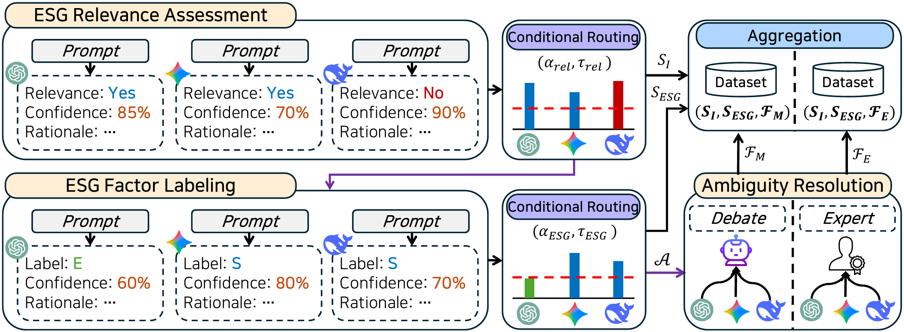

# TRAE

[](#-citation)
[](LICENSE)

**TRAE: Trustworthy Automated ESG Annotation via Multi-Agent Consensus and Confidence Assessment**

Official implementation of our paper accepted at **ICDM 2026**.

The ESG-EN dataset and its annotation traces will be released after the paper presentation at ICDM 2026.

TRAE is a multi-agent framework for trustworthy ESG annotation that integrates consensus-based decisions, confidence assessment, and agent debate with judge-based evaluation.

This repository provides the official **TRAE annotation pipeline**, including agent prompts, provider adapters, confidence-based routing, and reproducible execution scripts.

The framework was used to construct ESG-EN, an English ESG annotation dataset
that will be released with the official project materials.

## TRAE Overview

<p align="center">
  
</p>

<p align="center"><em>TRAE combines multi-agent relevance assessment and ESG factor labeling with confidence-based routing, debate, judge resolution, and final aggregation.</em></p>

## 📦 Resources

| Resource | Description | Link |
|---|---|---|
| **TRAE** | Multi-agent ESG annotation framework and source code. | This repository |
| **ESG-EN** | English ESG annotation dataset constructed using TRAE. | Available after the ICDM 2026 presentation |

Loading instructions will be added when ESG-EN is publicly released.

## 🔍 TRAE Pipeline

TRAE assigns English sentences to four categories:

- **E:** Environmental
- **S:** Social
- **G:** Governance
- **I:** ESG-irrelevant

The annotation process consists of three routed stages:

1. **Relevance Assessment:** Three independent annotators evaluate every input
   sentence. Accepted negative decisions are finalized as `I`; all other
   sentences proceed to Step 2.
2. **ESG Classification:** The annotators assign labels, confidence scores,
   supporting evidence, and brief rationales only to sentences routed from
   Step 1. Accepted decisions are finalized; unresolved sentences proceed to
   Step 3.
3. **Debate and Judgment:** Only unresolved Step 2 cases undergo agent debate
   and judge-based assessment. The judge selects the final label from
   `E`, `S`, `G`, and `I`.

### Confidence-Based Annotation

The default Step 1 and Step 2 thresholds match the high-confidence selection
rule used for **ESG-EN Silver+**:

- All three annotators must agree on the decision.
- Each supporting confidence score must be at least **0.90**.
- Accepted Step 1 negative decisions are assigned `I`.
- Accepted Step 2 decisions receive the agreed ESG label.
- Step 2 cases that do not meet the rule proceed to Step 3.
- The Step 3 judge makes the final label decision after reviewing the debate.

For the published ESG-EN Silver+ dataset, cases outside the accepted Step 1 and
Step 2 routes were finalized by human annotation. The released Step 3 responses
are provided as annotation traces. The public TRAE implementation instead
completes those routed cases through debate and a final judge decision.

This repository includes the dataset-construction pipeline, prompts, provider adapters, and a deterministic dry run. Experimental ablations, classifier training, and tier-comparison scripts are not included.

## 🚀 Quick Start

### Installation

Python 3.10 or newer is required.

```bash
git clone https://github.com/nowzer0/TRAE.git
cd TRAE

pip install -e .
```

### Prepare Input Data

TRAE accepts a UTF-8 CSV file containing a `sentence` column.

An `id` column is recommended. If omitted, IDs are generated from row order.

The following optional metadata columns are preserved:

- `year`
- `report`
- `sector`
- `industry`
- `company`

### Run Annotation

Set your API key and execute the annotation pipeline:

```bash
export GEMINI_API_KEY="your-api-key"

python run_annotation.py \
  --input examples/sample_input.csv \
  --out_dir runs/sample \
  --provider gemini \
  --model gemini-2.5-flash-lite
```

### Custom Consensus and Confidence

The default thresholds are:

| Parameter | Default | Description |
|---|---|---|
| `--consensus` | `3` | Number of matching annotator votes required |
| `--confidence` | `0.90` | Minimum confidence threshold |

These thresholds can be adjusted when applying TRAE to other datasets:

```bash
python run_annotation.py \
  --input examples/sample_input.csv \
  --out_dir runs/custom \
  --consensus 2 \
  --confidence 0.80 \
  --provider openai \
  --model YOUR_MODEL
```

`--consensus` accepts `2` or `3`. `--confidence` accepts values between `0`
and `1`. As in the research prompt, the Step 3 judge reports
`judge_confidence`; it is retained as trace metadata and is not used as an
additional acceptance threshold in the released pipeline.

### Multi-Model Configuration

Different models can be assigned to annotators A, B, C, and the judge.

Edit [`examples/agents_mixed.example.json`](examples/agents_mixed.example.json) and provide the configuration file:

```bash
python run_annotation.py \
  --input examples/sample_input.csv \
  --out_dir runs/mixed \
  --agent_config examples/agents_mixed.example.json
```

API keys are read from environment variables and must not be stored in the configuration file.

### Dry Run

To verify the complete pipeline without making external API calls:

```bash
python run_annotation.py \
  --input examples/sample_input.csv \
  --out_dir runs/dry-run \
  --dry_run
```

## Unresolved API Responses

TRAE retries malformed or failed model responses. If a valid Step 3 judge label
still cannot be obtained after the retries, the case is written to
`unresolved_annotations.csv` for inspection.

## 📁 Outputs

TRAE generates intermediate annotation records, consensus decisions, debate traces, and final annotations.

| File | Description |
|---|---|
| `step1_A/B/C.csv` | Relevance assessment responses from each annotator |
| `step1_aggregate.csv` | Step 1 votes, confidence scores, and routing decisions |
| `step2_A/B/C.csv` | ESG classification responses for cases routed from Step 1 |
| `step2_aggregate.csv` | Step 2 votes, confidence scores, and routing decisions |
| `step3_debate_raw.csv` | Debate and judge responses for unresolved Step 2 cases |
| `step3_final.csv` | Final judge labels, confidence values, and rationales |
| `final_annotations.csv` | Final annotation records for each input sentence |
| `unresolved_annotations.csv` | Cases without a valid final label after retries |
| `summary.json` | Annotation completion statistics grouped by label source |

The agent responses and normalized routing decisions will be distributed with
ESG-EN after the official release.

Source sustainability reports are not redistributed with ESG-EN.

## 🔬 Reproducibility

Language-model APIs and hosted model versions may change over time, potentially affecting annotation results.

For reproducibility, we recommend preserving:

- Raw agent responses and judge decisions
- Exact model identifiers
- Package and dependency versions
- Execution dates
- Source code revision

## 📄 License

TRAE source code is released under the [Apache License 2.0](LICENSE).

Upon release, the ESG-EN dataset will be distributed separately under
[CC BY-NC 4.0](https://creativecommons.org/licenses/by-nc/4.0/), subject to
applicable third-party data terms.

## 📝 Citation

If you use TRAE or ESG-EN, please cite our paper:

```bibtex
@inproceedings{lee2026trae,
  title     = {{TRAE}: Trustworthy Automated {ESG} Annotation via Multi-Agent Consensus and Confidence Assessment},
  author    = {Lee, Jaeyoung and Kim, Misuk},
  booktitle = {Proceedings of the 2026 IEEE International Conference on Data Mining (ICDM)},
  year      = {2026}
}
```

*The citation will be updated with the official publication details when available.*
